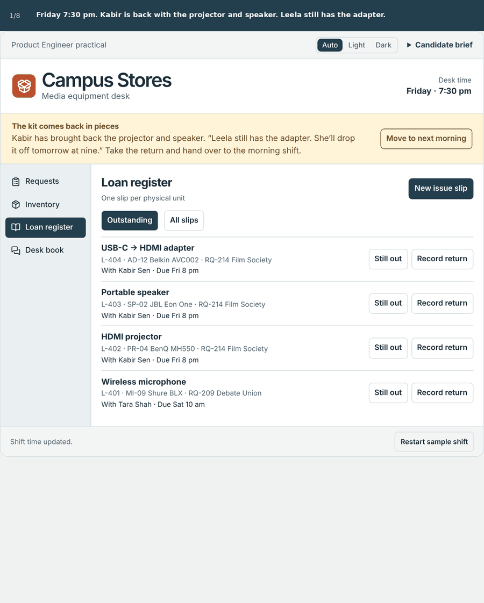
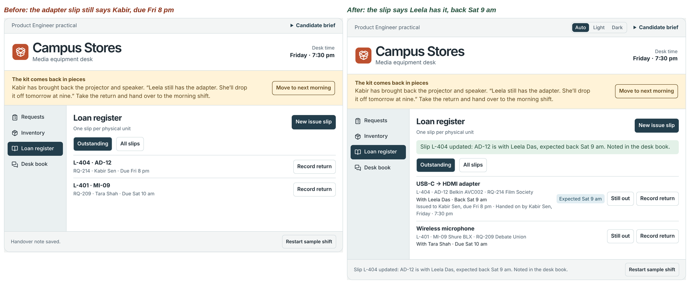
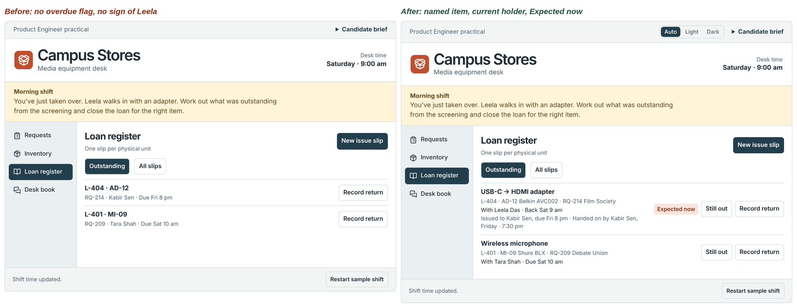
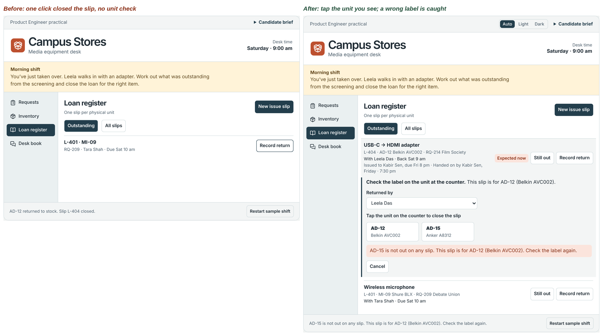

# Campus Stores: would I keep it?

**Try it:** [Live app](https://ed22b018-code.github.io/campus-stores/) · [Run the 19 shift checks](https://ed22b018-code.github.io/campus-stores/tests.html) · [All my commits](https://github.com/ed22b018-code/campus-stores/compare/aeeba26...main)



## Short answer

**Yes, I'd keep it, with one change.**

Getting kit out of the door safely works well. The app checks every unit against the approved request, so the expensive mistakes at pickup can't happen. Where it breaks is the moment the kit **splits between people**. When Kabir said "Leela still has the adapter, she'll drop it off at nine," the app had nowhere to put that. The only place for it was a free-text note. The next morning, the register still said *Kabir, due Fri 8 pm*, showed nothing as overdue, and let me close the slip without checking which of two identical adapters had come back.

So my change makes **the loan slip carry the handover.**

## The shift I worked

I played the shift on the original app as a desk worker would, including a few deliberate mistakes.

| Desk time | What I did | What the original app did |
|---|---|---|
| Fri 3:45 pm | Issued a camera against the Film Society request | **Refused**: outside the approved request ✅ |
| Fri 3:45 pm | Looked for a second projector; tried a second speaker | The Epson in the workshop was never offered; the second speaker was **refused** ✅ |
| Fri 3:45 pm | Issued the projector to Dev Menon, due Sat noon | Saved without a warning |
| Fri 7:30 pm | Recorded the projector and speaker returns | Fine, because each unit has its own slip |
| Fri 7:30 pm | Tried to record that Leela has the adapter until 9 am | **No way to.** The slip stayed *Kabir Sen · Due Fri 8 pm*; I could only write a desk book note |
| Fri 7:30 pm | Mis-clicked *Record return* on the adapter | Closed at once, **no check and no undo**. Inventory showed AD-12 on the shelf while Leela had it |
| Sat 9:00 am | Took over and opened the register | Adapter 13 hours past due, **no overdue flag**, Leela on no slip |
| Sat 9:00 am | Leela handed over "an adapter" | *Record return* never asked which unit. AD-12 and AD-15 are identical and share bin C4 |

## One moment it handles well

**Fri 3:45 pm, at pickup.** I tried to issue a camera against the Film Society request and it was refused. I tried to add a second speaker and that was refused too. The projector in the workshop never appeared as an option.

These are the costly counter mistakes: broken kit going out, or kit the club wasn't approved for. The app prevents them when the slip is written, not after something goes missing. Because every physical unit gets its own slip, a partial return is even possible to record. My change builds on that.

## One moment I'd change

**Fri 7:30 pm → Sat 9:00 am, the adapter that stayed with Leela.**

The real-world cost:
- The morning shift chases **the wrong person** (Kabir).
- Nobody notices the item is **overdue**, so a missing adapter isn't followed up until someone needs it.
- The right slip can be closed against the **wrong unit**, leaving stock records that don't match the shelf.

The information wasn't lost; Kabir said exactly where the adapter was. The product just had nowhere structured to put it.

## My change: the slip carries the handover

1. **Still out.** On an open slip, record *who has the unit now* and *when it's expected back*. The slip keeps who it was issued to and the original due time, so nothing is overwritten. A matching desk book entry is written automatically, so the slip and the book can't disagree.
2. **A register you can read at a glance.** Rows name the equipment (*USB-C → HDMI adapter*), not just `AD-12`, and show who has it now. Tags read **Overdue since …**, **Due now** or **Expected …**, measured against desk time. Inventory shows who has each unit.
3. **Return the unit you're holding.** *Record return* shows each unit of that type as a button: you tap the label you can read. A mismatch is refused with an explanation. *Returned by* is prefilled with whoever has it, and there's an **Undo**.

**Why on the slip, not a better desk book?** The register is where the morning shift goes to close loans. The desk book is still there for human context, like Isha's "issue it in Kabir's name," but the facts needed to close a loan now live where the loan is closed.

**The trade-off I accepted:** returns take one more tap. Returns are the most common action at a desk, so I made the check a single tap instead of a dropdown plus a confirm button. If a month of use showed it never caught a wrong label, I would only ask when look-alike units exist.

## The same job, using the change

| Desk time | What I do now | What the desk sees |
|---|---|---|
| Fri 3:45 pm | Issue projector, speaker and adapter to Kabir | Same as before: the request checks still apply |
| Fri 7:30 pm | Tap PR-04, then SP-02 | Both slips close, with Undo |
| Fri 7:30 pm | Adapter → **Still out** → Leela Das, Sat 9 am | *With Leela Das · Back Sat 9 am*; desk book entry added |
| Sat 9:00 am | Open the register | **Expected now** next to Leela's name |
| Sat 9:00 am | Tap **AD-15** by mistake | Refused: "This slip is for AD-12 (Belkin AVC002)" |
| Sat 9:00 am | Tap **AD-12** | Closed in Leela's name; inventory shows AD-12 back on the shelf |

If nobody records the handover on Friday night, the adapter shows **Overdue since Fri 8 pm** on Saturday instead of looking normal.





## What I'd keep

- **One slip per physical unit.** It's what makes partial returns workable at all.
- **Checking each slip against the approved request** for type, quantity and units in repair.
- **Inventory worked out from the slips,** so there's no second list to drift out of sync.
- **The desk book** for things that don't belong on a slip, like who a club has authorised to collect.

## One observation at a real counter

For the first two weeks, at each opening, before anyone reads the desk book, the opener goes down the outstanding list with the supervisor and answers two questions for every open slip: **who has it, and when is it back?** Count the slips they can't answer from the register alone.

Saturday's adapter would have been one of those. If the count isn't close to zero after two weeks, the change hasn't helped: staff are still putting handovers in the book instead of on the slip, and I'd look at why.

## What I deliberately didn't do

- **Issue a whole kit in one go at pickup.** Today that's three separate slips, and nothing shows the kit is complete. I ranked it lower because the club host is standing at the counter during pickup, so a missing adapter tends to be noticed then. A partial return is the unattended gap overnight.
- **Check who is allowed to collect.** Dev Menon could collect the Film Society kit. Authorisation sits in a desk book note today. It's worth fixing, but it's a different moment.
- **Barcode scanning, messages to Leela, or a shared backend.** All useful in a real deployment, and all out of scope for a prototype that runs offline from one file.

## Small extras

These sit on the same screens but aren't part of the argument above:
- An **Auto / Light / Dark** switch in the top bar (separate commit).
- Messages appear next to the action as well as in the status bar.
- On narrow screens, the tab bar no longer stretches on short pages.

## How I checked it

- **[tests.html](https://ed22b018-code.github.io/campus-stores/tests.html)** replays the shift on the real app, with 19 checks. These cover the original pickup rules, the handover, the wrong-label catch, Undo, the overdue flag, and loading shifts saved by the original version. Run against the original app, it fails, as it should.
- I played the same story on the original and on my version, on desktop and at phone width, in light and dark mode, with no console errors.
- Shifts saved by the original version (storage v1) still load. Damaged or tampered saves are ignored.

## How I used AI

The brief allows any tools, so here's how I worked. I used Claude as a pair. It read the code, played the shift in a headless browser, drafted the code and this write-up, and ran the checks. The product calls were mine, and several went against its first suggestions:
- I kept to **one** change, after first wanting to fix three problems.
- I made the return check **a single tap** once it was clear the first version slowed down the most common action at the desk.
- I left the pickup flow alone and wrote down why.

I reviewed every change by replaying the shift myself.

## Beyond a campus desk

"Who has it now, and when is it coming back?" is the same question as a nursing shift handover, or a monitor moving between wards. The pattern holds: put custody on the record that gets closed, not in a note beside it.

---

## Run it locally

Open `index.html` in a modern browser; it works offline. To also run the checks, serve the folder over HTTP and open `tests.html`:

```sh
python3 -m http.server 8000 --bind 127.0.0.1
```

- `app.js`: sample records and interactions (my change is the `slip()` view, the *Still out* and *return* handlers, and storage v2)
- `styles.css`: layouts, plus the tag, panel and unit-button styles
- `index.html`: desk layout, candidate brief, theme switch
- `tests.html`: the shift checks
- `docs/`: walkthrough and before/after images

Icon license notices are in [third-party/lucide-LICENSE.txt](third-party/lucide-LICENSE.txt). All people, clubs and records are fictional.
